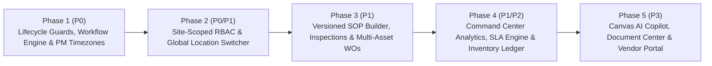

# AJ CAFM vs. SentrixFM — Reverse-Engineering Gap Analysis & Enhancement Blueprint

**Target Repository:** AJ CAFM (`aj-cafm` on Canvas — `atlas-cmms/` + `frontend/` + `mobile/`)  
**Active Branch & Baseline:** `migrate-python` (`atlas-cmms/` FastAPI + SQLAlchemy 2.0 + React SPA, migration revision `2624f8ef1da1`)  
**Comparison Source:** [`research/sentrixfm-research/`](file:///Users/attiliab/Documents/GitHub/cmms/research/sentrixfm-research/README.md) (Evidence IDs `S001–S107`, observed against `https://dev.sentrixfm.com`)  
**Companion Document:** [FACILIO_GAP_ANALYSIS.md](file:///Users/attiliab/Documents/GitHub/cmms/FACILIO_GAP_ANALYSIS.md) (Facilio 12-domain / 22-REA-target enterprise comparison)

---

## 1. Executive Summary & Architectural Baseline

This document synthesizes the reverse-engineered product architecture, workflows, domain model, and UI/UX patterns of **SentrixFM** (`S001–S107`) and maps them directly against our active **AJ CAFM** production codebase (`atlas-cmms/` Python FastAPI backend + `frontend/` React/TypeScript SPA + `mobile/` Expo app).

### 1.1 Crucial Baseline Shift (Legacy Java vs. Current Canvas Python Stack)

The upstream SentrixFM research package compared SentrixFM against the older Java Spring Boot branch (`unrestricted-selfhosted` at `8b29331d`). Since then, AJ CAFM has completed a full architectural migration to **Canvas (`aj-cafm`)**:

- **Backend (`atlas-cmms/`)**: Python 3.12 + FastAPI + SQLAlchemy 2.0 + `ajnkit-core` serving **241 REST API routes** across 6 domain routers (`atlas-cmms/src/routes/`), **72 ORM entity models + 53 association tables + 44 enums** (`atlas-cmms/src/models/`), background maintenance schedulers (`atlas-cmms/src/tasks.py`), and a universal foreign-key mini-DTO serializer (`atlas-cmms/src/services/serializer.py`).
- **Web App (`frontend/`)**: TypeScript/React + Redux Toolkit compiled into `atlas-cmms/src/static/` and `atlas-cmms/src/static/ui/` with **"Powered by Canvas"** branding and fixed root tree pagination (`/locations/children/0/paginated`, `/assets/children/0/paginated`).
- **Unrestricted Self-Hosted Policy (`UNRESTRICTED_SELFHOSTED.md`)**: `LicenseService.is_unrestricted_self_hosted()` grants all `PlanFeatures` (`WORKFLOW`, `ANALYTICS`, `IMPORT_TO_CSV`, `PURCHASE_ORDER`, `SIGNATURE`, `REQUEST_CONFIGURATION`, etc.) with zero license gates or numerical quotas.

### 1.2 High-Level Verdict: Substance vs. Surface Polish

Reverse-engineering SentrixFM revealed a sharp contrast between **enterprise FM conceptual framing** and **runtime implementation maturity**:

1. **Where SentrixFM Excels (What We Should Adopt)**:
   - **Location-Scoped Access & Context (`S015`, `S027–S029`, `S067–S074`)**: Global header location switcher, explicit `User × Location × Role × Team` assignment tuples, and separating `EXECUTE` vs `MANAGE` permissions.
   - **Work Order Governance & Workspace Density (`S001–S014`, `S092–S098`)**: Table/Kanban/Calendar workspace switchers, explicit Quality Check & Client Approval toggle gates (`S006`), quick preview drawer (`S013`, `S092`) paired with a durable 5-tab full-page workspace (`Overview`, `Cost & Time`, `Assets`, `SOP`, `History`), and multi-asset work order binding (`S095`).
   - **Versioned SOP & Inspection Builder (`S048–S054`)**: Separating reusable `SOP Templates` from `Executed Instances`, hierarchical sections/subsections, 9 structured field types (`Digital Signature`, `Photo Capture`, `File Upload`, `Date Picker`, etc.), and per-field validation rules (`Required`, `Min/Max`, `Regex`).
   - **Multi-Store Inventory & Requisitions (`S038–S042`)**: Separating physical `Inventory Stores` (warehouses/bins tied to locations), `Consumables/Parts` with SKU/UOM/min-max/expiry, and work-order-linked `Requisitions`.
   - **Explicit PPM Timezone & Service Discipline (`S043–S047`)**: First-class IANA timezone (`Asia/Qatar`) + execution clock time (`09:00`) + `Hard` vs `Soft` FM service classification.

2. **Where SentrixFM Is Broken or a Trial Shell (What We Must Avoid)**:
   - **KPI & State Contradictions (`S001–S003`, `S024–S025`, `S098`)**: Summary cards (`12`), table rows (`13`), and Kanban cards (`10`) disagree on the same dataset; work orders render with `Unknown Status` where clicking `Change Status` does nothing (`S098`).
   - **Broken Reporting & Unmapped Analytics (`S019–S020`, `S023`)**: Standard Report generation fails with `Cannot POST /api/rapport-management/work-order-summary` (`S020`), and Financial Analytics explicitly states cost fields are not yet mapped (`S023`).
   - **Empty / Static Secondary Shells (`S062`, `S079`, `S081`, `S083`, `S085–S089`)**: Maintenance Packages route is a blank shell (`S062`), File Library browse returns 404 (`S083`), AI Assistant is offline (`S081`), Email/SMS are `"Coming Soon"` (`S079`), and Invoices/Projects are static 2019 templates (`S085–S089`).

3. **Critical Hidden Gaps Discovered in Our Own `atlas-cmms/` Stack**:
   - **Workflow Rules Engine is CRUD-Only**: `atlas-cmms/src/routes/meters_requests_workflows_misc.py` persists `Workflow`, `WorkflowCondition`, and `WorkflowAction` (`atlas-cmms/src/models/workflows.py`), but **no runtime service evaluates or fires workflow actions** when a `WorkOrder`, `Request`, `Part`, or `Task` is created or updated.
   - **Permissive Work Order State Transitions**: `PATCH /work-orders/{id}` (`atlas-cmms/src/routes/work_orders_pm.py`) updates `status` directly without enforcing an allowed state transition graph, mandatory hold/reopen reasons, required checklist task completion, or signature verification before `COMPLETE`.
   - **Naive UTC Day-Delta PM Scheduler**: `generate_due_work_orders()` (`atlas-cmms/src/jobs/pm_generator.py`) advances `schedule.next_due_date` by `timedelta(days=freq_days)` in UTC without IANA timezone anchoring, occurrence deduplication keys, or completion-anchored recurrence options.

---

## 2. Master Capability Gap Matrix (18 Domains)

Priorities follow a strict engineering dependency order:
- **`P0` (Core Correctness & Operational Foundation)**: Must-have state integrity, runtime enforcement, and site-scoped access control.
- **`P1` (High-Value Enterprise CAFM Differentiation)**: Capabilities that elevate AJ CAFM into a full multi-site enterprise CAFM platform.
- **`P2` (Advanced Process & Supply-Chain Breadth)**: Multi-store inventory ledgers, requisition workflows, and multi-step maintenance packages.
- **`P3` (Platform Ecosystem & Canvas-Native Extensions)**: AI Copilot (via `ajnkit`), vendor/contract portals, and document center.

| # | Capability Domain | Priority | SentrixFM Observed State (`S001–S107`) | Current AJ CAFM State (`atlas-cmms/` + `frontend/`) | Concrete Gap & Recommended Action |
|---|---|---|---|---|---|
| **1** | **Location-Scoped RBAC & User Membership** | **P0** | Assigns `(User, Location, Role, Team)` tuples during onboarding (`S072`); separates `EXECUTE` vs `MANAGE` permissions (`S068`). | `OwnUser` (`src/models/users.py`) has a single `role_id` and `location_id`. Queries in `src/deps/company.py` scope by `company_id` only. | Add `UserLocationRole` membership model, enforce location-subtree query filtering in `src/deps/`, and split `EXECUTE` vs `MANAGE` permissions. |
| **2** | **Work Order Lifecycle & Approval Gates** | **P0** | 6-tab creation modal with `Quality Check` & `Client Approval` gates (`S006`); preview drawer (`S013`) + 5-tab full record (`S092–S098`). Status transitions buggy (`S098`). | `WorkOrder` (`src/models/work_orders.py`) has 4 statuses (`OPEN`, `IN_PROGRESS`, `ON_HOLD`, `COMPLETE`), `required_signature`, `feedback`, and `WorkOrderHistory`. No server transition guards. | Enforce state machine transitions, required-task/signature completion guard, hold/reopen reason capture, and optional `quality_check_required` / `client_approval_required` gates. |
| **3** | **Runtime Workflow Automation Engine** | **P0** | Visual workflow metadata (`S055–S061`, `S102–S104`) with Manual/Date/Cron triggers and condition rules. Runtime unverified. | `Workflow`, `WorkflowCondition`, `WorkflowAction` (`src/models/workflows.py`) have full CRUD in `src/routes/meters_requests_workflows_misc.py`, but **zero runtime execution**. | Build `atlas-cmms/src/services/workflow_engine.py` and invoke it on `WorkOrder`, `Request`, `Part`, and `Task` create/update hooks. |
| **4** | **PPM Recurrence, Timezone & Deduplication** | **P0** | Explicit execution time (`09:00`), IANA timezone (`Asia/Qatar` in `S045`), Month/Week/Day selectors, `Hard`/`Soft` service tags (`S043–S047`). | `Schedule` (`src/models/pm_schedule.py`) + `pm_generator.py` (`src/jobs/pm_generator.py`) runs every 60s (`src/tasks.py`) using naive UTC `timedelta(days=freq_days)`. | Add `timezone`, `execution_time`, `service_type` (`HARD`/`SOFT`), idempotent `PmOccurrence` ledger, and a next-N schedule preview endpoint. |
| **5** | **Multi-Asset Work Orders** | **P1** | Work Order `Assets` tab (`S095`) binds multiple assets (`#AST-001`, `#AST-002`) with per-asset status/serial cards to one WO. | `WorkOrder.asset_id` (`src/models/work_orders.py`) is a single foreign key to `Asset`. | Add a `work_order_assets` association/detail table while keeping primary `asset_id` backward-compatible for existing views. |
| **6** | **Portfolio & Location Hierarchy Context** | **P1** | Top-bar global location selector (`S015`), Hierarchy/Table/Map views (`S027`), level badges (`Level 0/1`), OSM coordinate picker (`S029`). | `Location` (`src/models/location_asset.py`) supports `parent_location_id`, `latitude`/`longitude`, and paginated children (`/locations/children/{id}/paginated`). | Add `location_type` enum (`PORTFOLIO`, `SITE`, `BUILDING`, `FLOOR`, `SPACE`), materialized path/subtree filter, and a global top-bar location context selector in `frontend/`. |
| **7** | **Asset 360 Workspace & Status History** | **P1** | Table/Tree registry (`S030`), Asset 360 tabs (`Overview`, `Work Orders`, `PPM`, `Documents`, `History` in `S033–S037`), QR print/share, contextual `Create WO` / `Schedule PPM`. | `Asset` (`src/models/location_asset.py`) has hierarchy, downtime (`AssetDowntime`), meters, parts, files, and work orders, but no status change log or contextual pre-filled creation modals. | Add `AssetStatusHistory` model, Asset 360 summary endpoint (MTTR/MTBF, total cost, open WOs/PMs), QR print modal, and pre-filled `Create WO` / `Schedule PM` buttons. |
| **8** | **Inspections & Versioned SOP Builder** | **P1** | Dedicated `Inspections` queue (`S048–S049`), `SOP Library` (`Templates` vs `Instances` `S050`), hierarchical `SOP Builder` (`S051–S054`) with 9 field types & regex/range validation. | `Checklist`, `TaskBase`, `Task` (`src/models/tasks.py`) with 6 `TaskType` values (`SUBTASK`, `NUMBER`, `TEXT`, `INSPECTION`, `MULTIPLE`, `METER`). In-place edits mutate templates. | Add template `version` snapshots, `section` grouping, new `TaskType`s (`SIGNATURE`, `PHOTO`, `FILE`, `DATE`, `CHECKBOX`), validation rules JSON, and auto-WO creation on failed inspection items. |
| **9** | **SLA Engine & Business Calendars** | **P1** | Displays `SLA Compliance %` KPI (`S022`, `S024`), though policy administration was not exposed in the tenant UI. | `WorkOrder` has `priority` and `due_date`, plus `downtime_notifier.py` and `pm_notifier.py`, but no formal SLA response/resolution clocks or pause-on-hold tracking. | Add `SlaPolicy` (by priority/category/location), `response_due_at`, `resolution_due_at`, pause-on-hold duration accumulation, and SLA breach escalation notifications. |
| **10** | **Command Center & Truthful Analytics** | **P1** | `Analytics Dashboard` (`Command Center`, `Operations`, `Financials` `S021–S023`) + `Location Dashboard` (`S024–S026`). Plagued by count mismatches and broken report POST (`S020`). | `src/routes/analytics.py` serves 40+ `/analytics/*` endpoints and PDF exports, backed by live SQL queries on primary routes and baseline stubs on secondary routes. | Add a unified **Manager Exception Queue** (Unassigned Urgent, Overdue, SLA At-Risk, Low Stock) where every KPI card shares the exact SQL specification used by the drill-down list. |
| **11** | **Service Requests & Intake Portal** | **P1** | Separate `Requests` module (`S063–S066`) with requester auto-fill, category/priority/location/asset binding, and dynamic custom form fields. | `Request` (`src/models/requests_meters.py`) + `approve`/`cancel` flows (`src/routes/meters_requests_workflows_misc.py`) + `CustomField`. | Enhance request intake with QR-code public/requester-scoped submission, explicit conversion status synchronization (`CONVERTED`, `IN_EXECUTION`, `CLOSED`), and requester feedback loop. |
| **12** | **Inventory Stores, Bins & Requisitions** | **P2** | `Inventory Stores` tied to locations (`S038–S039`), `Consumables` with SKU/UOM/min-max/expiry (`S041–S042`), and WO-linked `Requisitions` (`S040`). | `Part`, `MultiParts`, `PartQuantity`, `PartConsumption`, `PurchaseOrder` (`src/models/parts_po.py`). Single global `quantity` per `Part`; no store/bin split or reservation ledger. | Add `InventoryStore` (linked to `Location`), `PartStoreBalance`, `MaterialRequisition`, and an immutable `InventoryLedgerEntry` (`RESERVE`, `ISSUE`, `CONSUME`, `RETURN`, `ADJUST`, `RECEIVE`). |
| **13** | **Purchase Orders & Receiving Workflow** | **P2** | Covered conceptually via Requisitions (`S040`) and Invoices shell (`S088–S089`). | `PurchaseOrder` + `PurchaseOrderLineItem` (`src/models/parts_po.py`, `src/routes/parts_po_tasks.py`) with `approve`/`reject` endpoints. | Separate PO approval from physical stock receipt (`POST /purchase-orders/{id}/receive`) supporting partial delivery and automatic `InventoryLedgerEntry` creation. |
| **14** | **Maintenance Packages (Multi-Step Work)** | **P2** | `Workflow` $\rightarrow$ `Maintenance Package` $\rightarrow$ `Working Item` with Parallel vs Sequential strategies (`S059`, `S104`). Standalone route was blank (`S062`). | Single-work-order `PreventiveMaintenance` (`src/models/pm_schedule.py`) and `Relation` links between work orders (`src/models/work_orders.py`). | Introduce `MaintenancePackage` templates that spawn coordinated multi-craft child work orders or sequential/parallel task groups without requiring a heavy BPMN canvas first. |
| **15** | **Vendors, Customers & Subcontractors** | **P2** | Contractor assignment referenced on work orders; Invoices shell (`S088`). | `Vendor` and `Customer` models & routes exist (`src/models/parts_po.py`, `src/routes/assets_locations.py`) and are enabled in `LicenseService`, but hidden from the sidebar (`UNRESTRICTED_SELFHOSTED.md`). | Re-enable `Vendors` and `Customers` in the `frontend/` navigation sidebar and add vendor SLA/contract expiry metadata. |
| **16** | **Mobile Technician & Responsive Ergonomics** | **P1** | Responsive web (`S099–S101`) stacked summary cards above the fold and lost mobile tab `aria-label`s. | Native Expo app (`mobile/`) + responsive Material-UI web app (`frontend/`). | Keep technician mobile views task-first (collapse KPI cards on `<768px`, sticky bottom action bar for `Start` / `Log Time` / `Complete`, offline-ready checklist execution). |
| **17** | **Document Center & File Repository** | **P3** | `File Library` (`S082–S084`) with category chips (`Manuals`, `SOPs`, `Certificates`) — failed with 404 on browse (`S083`). | `File` model (`src/models/files_imports.py`) + working upload/download routes (`src/routes/meters_requests_workflows_misc.py`). | Add document category tags (`MANUAL`, `SOP`, `CERTIFICATE`, `WARRANTY`), expiry date tracking, and a unified Document Browser view over existing `File` records. |
| **18** | **Canvas-Native AI Maintenance Copilot** | **P3** | `Sentrix AI Assistant` drawer (`S080–S081`) with starter prompts — backend offline (`S081`). | Hosted on **Canvas (`aj-cafm`)** with `ajnkit-core` already integrated. | Build a real, permission-scoped Maintenance Copilot using Canvas SDK (`ajnkit`) for natural-language WO search, SOP drafting from manuals, and root-cause summaries. |

---

## 3. Deep-Dive Technical Gap Analysis by Domain

Each subsection below maps SentrixFM's reverse-engineered design to the exact files in `atlas-cmms/` and `frontend/`, identifying what we already have, what is missing, and how to implement it cleanly.

### 3.1 Domain 1: Location-Scoped RBAC & Organization Model (`P0`)

- **SentrixFM Evidence (`S067–S074`, `LOCATION_MODEL_SPEC.md`, `REQUESTS_ORGANIZATION_ACCESS_SPEC.md`)**:
  - Roles (`S067–S068`) separate operational execution (`WORK_ORDER_EXECUTE`, `INSPECTION_EXECUTE`, `ASSET_VIEW`) from supervision (`WORK_ORDER_MANAGE`, `ASSET_MANAGE`, `LOCATION_MANAGE`).
  - User creation (`S072`) binds a user to **one or more Location + Role + Team assignments**, meaning a technician at `Demo Branch` can execute work orders there without seeing or mutating `Main Office` governance settings.
- **Current AJ CAFM Implementation**:
  - Models: [`OwnUser`](file:///Users/attiliab/Documents/GitHub/cmms/atlas-cmms/src/models/users.py), [`Role`](file:///Users/attiliab/Documents/GitHub/cmms/atlas-cmms/src/models/users.py), [`Team`](file:///Users/attiliab/Documents/GitHub/cmms/atlas-cmms/src/models/users.py), and [`Location`](file:///Users/attiliab/Documents/GitHub/cmms/atlas-cmms/src/models/location_asset.py).
  - Dependencies: [`atlas-cmms/src/deps/auth.py`](file:///Users/attiliab/Documents/GitHub/cmms/atlas-cmms/src/deps/auth.py) and [`atlas-cmms/src/deps/company.py`](file:///Users/attiliab/Documents/GitHub/cmms/atlas-cmms/src/deps/company.py).
  - Currently, `OwnUser.role_id` grants a single company-wide `Role` (with `view_permissions`, `create_permissions`, `edit_other_permissions`, `delete_other_permissions` arrays of ` PermissionEntity`), and `OwnUser.location_id` is a single nullable FK that is not enforced as a mandatory subtree filter in [`apply_search_criteria`](file:///Users/attiliab/Documents/GitHub/cmms/atlas-cmms/src/utils/search.py).
- **Recommended Engineering Specification**:
  1. **New ORM Model (`UserLocationScope` in `atlas-cmms/src/models/users.py`)**:
     - Columns: `id`, `company_id`, `user_id` (`FK -> own_user.id`), `location_id` (`FK -> location.id`), `role_id` (`FK -> role.id`), `team_id` (`FK -> team.id`, nullable), `include_descendants` (`bool`, default `True`).
  2. **Subtree Scoping Helper (`atlas-cmms/src/deps/company.py`)**:
     - Add `get_accessible_location_ids(db: Session, user: OwnUser, selected_location_id: int | None = None) -> set[int] | None` (returns `None` for unrestricted company admins, or the union of allowed location IDs + their descendant tree IDs).
  3. **Global Location Switcher (`frontend/src/layouts/ExtendedSidebarLayout/Header/`)**:
     - Add a top-bar Location Context selector (`All Locations` or a specific Site/Building subtree) that passes a global `locationScopeId` header or search filter Criterion across Work Orders, Assets, PPM, Parts, and Analytics.

---

### 3.2 Domain 2: Work Order Lifecycle, State Machine & Multi-Asset Binding (`P0` / `P1`)

- **SentrixFM Evidence (`S001–S014`, `S092–S098`, `WORK_ORDER_SPEC.md`, `FULL_RECORD_AND_BUILDER_SUPPLEMENT.md`)**:
  - **Creation Modal (`S005–S011`)**: 6-step tabbed dialog (`Basic Info`, `Classification`, `Location & Assets`, `Assignment`, `Scheduling`, `Review`) with two high-value governance toggles on `Classification` (`S006`):
    - `Quality Check Required` (supervisor verification gate before closure)
    - `Client Approval Required` (requester/tenant sign-off gate before closure)
  - **Two-Tier Detail Ergonomics (`S013`, `S092–S098`)**:
    - Quick right-hand preview drawer (`S013`, `S092`) for rapid triage (`Change Status`, `View Full Details`).
    - Full-page workspace (`S093–S098`) with 5 tabs: `Overview`, `Cost & Time` (Labor Cost, Material Cost, Total Cost, Actual Hours), `Assets` (multi-asset cards `S095`), `SOP` (`S096`), and `History` (`S097`).
- **Current AJ CAFM Implementation**:
  - Models: [`WorkOrder`](file:///Users/attiliab/Documents/GitHub/cmms/atlas-cmms/src/models/work_orders.py), [`WorkOrderHistory`](file:///Users/attiliab/Documents/GitHub/cmms/atlas-cmms/src/models/work_orders.py), [`Labor`](file:///Users/attiliab/Documents/GitHub/cmms/atlas-cmms/src/models/work_orders.py), [`AdditionalCost`](file:///Users/attiliab/Documents/GitHub/cmms/atlas-cmms/src/models/work_orders.py), [`Relation`](file:///Users/attiliab/Documents/GitHub/cmms/atlas-cmms/src/models/work_orders.py).
  - Routes: [`atlas-cmms/src/routes/work_orders_pm.py`](file:///Users/attiliab/Documents/GitHub/cmms/atlas-cmms/src/routes/work_orders_pm.py).
  - Frontend: [`frontend/src/content/own/WorkOrders/`](file:///Users/attiliab/Documents/GitHub/cmms/frontend/src/content/own/WorkOrders).
  - **Gaps**:
    1. `WorkOrder` status is an unguarded enum (`OPEN`, `IN_PROGRESS`, `ON_HOLD`, `COMPLETE`). A user can jump from `OPEN` directly to `COMPLETE` even when `required_signature=True` and `signature_id` is `None`, or when mandatory checklist tasks (`Task`) are incomplete.
    2. Moving to `ON_HOLD` or reopening from `COMPLETE` does not require a structured reason code (`AWAITING_PARTS`, `AWAITING_VENDOR`, `ACCESS_DENIED`, `CLIENT_HOLD`).
    3. `WorkOrder` only links to a single `asset_id` rather than supporting multi-asset rounds (e.g., inspecting 10 fire extinguishers on one floor under a single work order).
- **Recommended Engineering Specification**:
  1. **State Transition Guard (`atlas-cmms/src/services/work_order_lifecycle.py`)**:
     - Enforce allowed transitions and pre-completion invariants:
       - Before `status == COMPLETE`: verify all required `Task` rows on the work order are completed/answered, verify `signature_id is not None` if `required_signature` is `True`, and verify `quality_verified_by_id` / `client_approved_by_id` if those gates are enabled.
       - Require `hold_reason` when transitioning to `ON_HOLD` and record a structured [`WorkOrderHistory`](file:///Users/attiliab/Documents/GitHub/cmms/atlas-cmms/src/models/work_orders.py) entry on every state transition.
  2. **Quality & Client Approval Columns on `WorkOrder` (`atlas-cmms/src/models/work_orders.py`)**:
     - `quality_check_required: Mapped[bool]`, `quality_verified_by_id: Mapped[int | None]`, `quality_verified_at: Mapped[datetime | None]`.
     - `client_approval_required: Mapped[bool]`, `client_approved_by_id: Mapped[int | None]`, `client_approved_at: Mapped[datetime | None]`.
     - `hold_reason: Mapped[str | None]`, `actual_start_date: Mapped[datetime | None]`.
  3. **Multi-Asset Association (`work_order_assets` in `atlas-cmms/src/models/associations.py`)**:
     - Link a `WorkOrder` to multiple `Asset` records (`work_order_id`, `asset_id`, `notes`, `status`) while keeping `WorkOrder.asset_id` synchronized with the primary asset so all existing tables, calendars, and analytics remain 100% compatible.

---

### 3.3 Domain 3: Runtime Workflow Automation Engine (`P0`)

- **SentrixFM Evidence (`S055–S062`, `S102–S104`, `VISUAL_WORKFLOW_SPEC.md`)**:
  - Combines trigger rules (`Manual`, `Specific Date`, `Schedule (Cron)` in `S103`) with condition builders (`equals`, `not_equals`, `greater_than`, `contains`, `in` in `S058`) and action assignments.
  - However, SentrixFM's standalone Maintenance Packages route rendered a blank shell (`S062`), proving that visual BPMN chrome without a rock-solid backend execution engine delivers negative operational value.
- **Current AJ CAFM Implementation**:
  - Models: [`Workflow`](file:///Users/attiliab/Documents/GitHub/cmms/atlas-cmms/src/models/workflows.py), [`WorkflowCondition`](file:///Users/attiliab/Documents/GitHub/cmms/atlas-cmms/src/models/workflows.py), [`WorkflowAction`](file:///Users/attiliab/Documents/GitHub/cmms/atlas-cmms/src/models/workflows.py) with rich enums (`WFMainCondition`: `WORK_ORDER_CREATED`, `WORK_ORDER_MODIFIED`, `REQUEST_CREATED`, `REQUEST_APPROVED`, `PART_UPDATED`, `TASK_UPDATED`, `PURCHASE_ORDER_UPDATED`; `WFActionType`: `ASSIGN_USER`, `ASSIGN_TEAM`, `ASSIGN_PRIORITY`, `ASSIGN_ASSET`, `ASSIGN_LOCATION`, `ASSIGN_CATEGORY`, `ADD_CHECKLIST`, `SEND_REMINDER_EMAIL`, `CREATE_WORK_ORDER`, `CREATE_REQUEST`, `CREATE_PURCHASE_ORDER`, `SET_ASSET_STATUS`).
  - Routes: [`atlas-cmms/src/routes/meters_requests_workflows_misc.py`](file:///Users/attiliab/Documents/GitHub/cmms/atlas-cmms/src/routes/meters_requests_workflows_misc.py#L446-L523) implements `GET/POST/PATCH/DELETE /workflows`.
  - **Gap**: There is **no workflow evaluation service** called when entities are created or modified in `atlas-cmms/src/routes/`.
- **Recommended Engineering Specification**:
  1. **Create [`atlas-cmms/src/services/workflow_engine.py`](file:///Users/attiliab/Documents/GitHub/cmms/atlas-cmms/src/services/)**:
     - `evaluate_workflows(db: Session, company_id: int, trigger: WFMainCondition, entity: Any) -> list[dict]`:
       - Queries active (`enabled == True`) `Workflow` definitions for `company_id` matching `main_condition == trigger`.
       - Evaluates all `WorkflowCondition` predicates (`work_order_condition`, `request_condition`, `part_condition`, `task_condition`, `purchase_order_condition`) against `entity`.
       - Executes matching `WorkflowAction` mutations (e.g., auto-assigning priority/team/user/checklist, setting asset status, or spawning a corrective `WorkOrder` when an inspection `Task` fails) with loop-prevention depth protection (`max_depth=1`) and audit logging.
  2. **Hook into Route Handlers**:
     - Call `evaluate_workflows()` inside `create_work_order` / `update_work_order` ([`work_orders_pm.py`](file:///Users/attiliab/Documents/GitHub/cmms/atlas-cmms/src/routes/work_orders_pm.py)), `create_request` / `approve_request` ([`meters_requests_workflows_misc.py`](file:///Users/attiliab/Documents/GitHub/cmms/atlas-cmms/src/routes/meters_requests_workflows_misc.py)), and `update_task` / `update_part` ([`parts_po_tasks.py`](file:///Users/attiliab/Documents/GitHub/cmms/atlas-cmms/src/routes/parts_po_tasks.py)).

---

### 3.4 Domain 4: Preventive Maintenance (PPM) Scheduling & Occurrence Engine (`P0`)

- **SentrixFM Evidence (`S043–S047`, `PPM_SPEC.md`)**:
  - Exposes `Execution Time` (`09:00`), explicit IANA `Timezone` (`Asia/Qatar` in `S045`), `Months` / `Weeks` / `Days` multi-select recurrence matrices, `Estimated Duration`, and `Hard` vs `Soft` service classification (`S044–S046`).
- **Current AJ CAFM Implementation**:
  - Models: [`PreventiveMaintenance`](file:///Users/attiliab/Documents/GitHub/cmms/atlas-cmms/src/models/pm_schedule.py) and [`Schedule`](file:///Users/attiliab/Documents/GitHub/cmms/atlas-cmms/src/models/pm_schedule.py) (`starts_on`, `ends_on`, `frequency`, `due_date_delay`, `next_due_date`, `recurrence_type`, `recurrence_based_on`, `days_of_week`).
  - Background Job: [`generate_due_work_orders`](file:///Users/attiliab/Documents/GitHub/cmms/atlas-cmms/src/jobs/pm_generator.py) invoked every 60 seconds by [`atlas-cmms/src/tasks.py`](file:///Users/attiliab/Documents/GitHub/cmms/atlas-cmms/src/tasks.py).
  - **Gaps**:
    1. `pm_generator.py` computes `schedule.next_due_date = now + timedelta(days=freq_days)` in UTC without respecting `recurrence_type` (`DAILY`, `WEEKLY`, `MONTHLY`, `YEARLY`), `days_of_week`, `recurrence_based_on` (`SCHEDULED_DATE` vs `COMPLETED_DATE`), or local facility timezone (`zoneinfo.ZoneInfo`).
    2. It does not copy the PM's associated checklists/tasks, assigned users (`preventive_maintenance_assigned_to`), or files onto the generated `WorkOrder`.
    3. There is no idempotency/deduplication ledger (`pm_id + scheduled_for_date`), nor a schedule preview endpoint for the UI.
- **Recommended Engineering Specification**:
  1. **Upgrade [`atlas-cmms/src/jobs/pm_generator.py`](file:///Users/attiliab/Documents/GitHub/cmms/atlas-cmms/src/jobs/pm_generator.py)**:
     - Compute next occurrences using `zoneinfo` (defaulting to company timezone or `Asia/Qatar` / `UTC`), honoring `RecurrenceType` (`DAILY`, `WEEKLY` with `days_of_week`, `MONTHLY`, `YEARLY`) and `RecurrenceBasedOn` (`SCHEDULED_DATE` vs `COMPLETED_DATE`).
     - Copy `assigned_to` users, `TaskBase` checklist tasks (`preventive_maintenance_patch.tasks`), and `due_date_delay` into each spawned `WorkOrder`.
     - Guard against duplicate generation by checking whether a `WorkOrder` already exists for `(parent_preventive_maintenance_id, scheduled_slot)`.
  2. **Add Schedule Preview Endpoint (`POST /preventive-maintenances/preview-schedule` in `work_orders_pm.py`)**:
     - Returns the next 10 computed execution timestamps and due dates so planners can verify recurrence rules before saving.

---

### 3.5 Domain 5: Inspections & Versioned SOP Form Builder (`P1`)

- **SentrixFM Evidence (`S048–S054`, `INSPECTIONS_SOP_SPEC.md`)**:
  - **SOP Library (`S050`)**: Separates reusable `SOP Templates` from `SOP Instances` and provides a `SOP Builder` button.
  - **SOP Builder (`S051–S054`)**:
    - Hierarchical **Sections** and **Subsections** (`+ Add Section`, `+ Add Subsection`, `+ Add Field`).
    - **9 Field Types (`S054`)**: `Text Input`, `Text Area`, `Number Input`, `Date Picker`, `Checkbox`, `Dropdown Select`, `Digital Signature`, `File Upload`, `Photo Capture`.
    - **Per-Field Validation (`S053`)**: `Required Field`, `Min Length`, `Max Length`, `Min Value`, `Max Value`, `Regex Pattern`, plus quick presets (`Email`, `URL`, `Alphanumeric`).
  - **Inspections Queue (`S048–S049`)**: Tracks scheduled/in-progress/completed inspections with pass/fail scoring.
- **Current AJ CAFM Implementation**:
  - Models: [`Checklist`](file:///Users/attiliab/Documents/GitHub/cmms/atlas-cmms/src/models/tasks.py), [`TaskBase`](file:///Users/attiliab/Documents/GitHub/cmms/atlas-cmms/src/models/tasks.py), [`Task`](file:///Users/attiliab/Documents/GitHub/cmms/atlas-cmms/src/models/tasks.py), [`TaskOption`](file:///Users/attiliab/Documents/GitHub/cmms/atlas-cmms/src/models/tasks.py) in `atlas-cmms/src/models/tasks.py`.
  - Enums: [`TaskType`](file:///Users/attiliab/Documents/GitHub/cmms/atlas-cmms/src/models/enums.py) (`SUBTASK`, `NUMBER`, `TEXT`, `INSPECTION`, `MULTIPLE`, `METER`).
  - Routes: [`atlas-cmms/src/routes/parts_po_tasks.py`](file:///Users/attiliab/Documents/GitHub/cmms/atlas-cmms/src/routes/parts_po_tasks.py#L430-L595).
- **Recommended Engineering Specification**:
  1. **Extend [`Checklist`](file:///Users/attiliab/Documents/GitHub/cmms/atlas-cmms/src/models/tasks.py) & [`TaskBase`](file:///Users/attiliab/Documents/GitHub/cmms/atlas-cmms/src/models/tasks.py)**:
     - Add `version: Mapped[int]` (default `1`), `status: Mapped[str]` (`DRAFT`, `PUBLISHED`, `ARCHIVED`), and `service_category: Mapped[str | None]` to `Checklist`.
     - Add `section_title: Mapped[str | None]`, `order_index: Mapped[int]`, `is_required: Mapped[bool]`, `validation_rules: Mapped[str | None]` (JSON string storing `min_value`, `max_value`, `regex`, `fail_values`, `auto_create_wo_on_fail`) to `TaskBase`.
     - Expand `TaskType` enum in [`atlas-cmms/src/models/enums.py`](file:///Users/attiliab/Documents/GitHub/cmms/atlas-cmms/src/models/enums.py) to include `CHECKBOX`, `DATE`, `SIGNATURE`, `PHOTO`, and `FILE`.
  2. **Failed Inspection Item $\rightarrow$ Corrective Work Order Trigger**:
     - When `PATCH /tasks/{id}` records a `FAIL` value (e.g. `value == "FAIL"` or out-of-range numeric reading) and `auto_create_wo_on_fail` (or a matching `TASK_UPDATED` Workflow rule) is active, automatically spawn a linked corrective `WorkOrder` inheriting `asset_id` and `location_id` from the parent work order.

---

### 3.6 Domain 6: Multi-Store Inventory, Requisitions & Immutable Stock Ledger (`P2`)

- **SentrixFM Evidence (`S038–S042`, `ASSETS_INVENTORY_SPEC.md`)**:
  - **Inventory Stores (`S038–S039`)**: Physical storerooms (`Store Name`, `Location`, `Description`, `Active Status`) so stock is tracked per site/warehouse rather than only as a single company-wide number.
  - **Consumables (`S041–S042`)**: Tracks `SKU`, `Unit` (`Pieces`, `Boxes`, `Kg`, `Liters`, `Meters`), `Stock Quantity`, `Minimum Stock`, `Maximum Stock`, `Unit Price`, `Purchase Price`, `Currency` (`QAR`, `USD`, `EUR`), `Expiry Date`, and `Specifications`.
  - **Requisitions (`S040`)**: Formal material request (`Title`, `Work Order`, `Priority`, `Notes`, line items) routing through approval before stock issue or PO generation.
- **Current AJ CAFM Implementation**:
  - Models: [`Part`](file:///Users/attiliab/Documents/GitHub/cmms/atlas-cmms/src/models/parts_po.py), [`MultiParts`](file:///Users/attiliab/Documents/GitHub/cmms/atlas-cmms/src/models/parts_po.py), [`PartQuantity`](file:///Users/attiliab/Documents/GitHub/cmms/atlas-cmms/src/models/parts_po.py), [`PartConsumption`](file:///Users/attiliab/Documents/GitHub/cmms/atlas-cmms/src/models/parts_po.py), [`PurchaseOrder`](file:///Users/attiliab/Documents/GitHub/cmms/atlas-cmms/src/models/parts_po.py) (`atlas-cmms/src/models/parts_po.py`).
  - Routes: [`atlas-cmms/src/routes/parts_po_tasks.py`](file:///Users/attiliab/Documents/GitHub/cmms/atlas-cmms/src/routes/parts_po_tasks.py).
  - **Gaps**:
    1. `Part.quantity` is a single float mutated directly on edit; there is no multi-store balance (`PartStoreBalance`) and no immutable `InventoryLedgerEntry` audit log explaining *why* stock changed (`RECEIVE`, `RESERVE`, `ISSUE`, `CONSUME`, `RETURN`, `ADJUST`).
    2. `PurchaseOrder` approval (`/purchase-orders/{id}/respond`) only flips `status = APPROVED`; there is no receiving endpoint that increments `Part.quantity` and records received quantities per line item.
- **Recommended Engineering Specification**:
  1. **Add `InventoryStore`, `PartStoreBalance`, and `InventoryLedgerEntry` (`atlas-cmms/src/models/parts_po.py`)**:
     - `InventoryStore`: `id`, `company_id`, `name`, `location_id`, `description`, `active`.
     - `InventoryLedgerEntry`: `id`, `company_id`, `part_id`, `store_id`, `work_order_id`, `purchase_order_id`, `movement_type` (`OPENING`, `RECEIVE`, `RESERVE`, `ISSUE`, `RETURN`, `ADJUST`), `quantity_delta`, `balance_after`, `unit_cost`, `reason`, `created_by`, `created_at`.
  2. **Add PO Receiving Endpoint (`POST /purchase-orders/{id}/receive` in `parts_po_tasks.py`)**:
     - Accepts received quantities per line item, increments `Part.quantity` (and store balance), writes `InventoryLedgerEntry(movement_type="RECEIVE")`, and updates PO status (`PARTIALLY_RECEIVED` / `RECEIVED`).

---

### 3.7 Domain 7: Dashboards, Command Center & SLA Analytics (`P1`)

- **SentrixFM Evidence (`S017–S026`, `DASHBOARDS_REPORTING_SPEC.md`)**:
  - **Analytics Dashboard (`S021–S023`)**: Split into `Command Center` (Completion Rate, Avg Resolution Time, Preventive Ratio, Active Asset Reliability, Technician Utilization, Cost Distribution), `Operations` (SLA Compliance %, Backlog Count, MTTR, MTBF), and `Financials` (Total Maintenance Spend, Cost per Work Order, Spend by Category).
  - **Location Dashboard (`S024–S026`)**: Site manager view with `Active Tasks`, `Top Asset Issues`, and `Maintenance Logistics` tabs.
  - **Failure Mode to Avoid (`S019–S020`, `S024–S025`)**: SentrixFM's KPI cards were decoupled from the filtered table queries (`12` vs `13` vs `10`) and its report export threw HTTP 404 (`Cannot POST /api/rapport-management/work-order-summary`).
- **Current AJ CAFM Implementation**:
  - Routes: [`atlas-cmms/src/routes/analytics.py`](file:///Users/attiliab/Documents/GitHub/cmms/atlas-cmms/src/routes/analytics.py) implements 40+ endpoints under `/analytics/work-orders/*`, `/analytics/assets/*`, `/analytics/parts/*`, `/analytics/requests/*`, and `/analytics/users/*`, including ReportLab PDF generation (`/export`).
  - **Gaps**:
    1. While primary overview endpoints (`/analytics/work-orders/complete/overview`, `/analytics/work-orders/mobile/overview`, `/analytics/assets/overview`, `/analytics/requests/overview`) query SQLAlchemy directly, several secondary breakdown routes in [`analytics.py`](file:///Users/attiliab/Documents/GitHub/cmms/atlas-cmms/src/routes/analytics.py) return baseline zeroed/empty array shapes and should be upgraded to full SQL aggregations.
    2. There is no single **Manager Command Center / Exception Queue** endpoint that surfaces actionable bottlenecks (`unassigned_urgent_wos`, `overdue_wos`, `on_hold_aging_wos`, `low_stock_parts`, `pending_requests`, `overdue_pms`) with one-click filter navigation.
- **Recommended Engineering Specification**:
  1. **Replace All Remaining Stubs in [`atlas-cmms/src/routes/analytics.py`](file:///Users/attiliab/Documents/GitHub/cmms/atlas-cmms/src/routes/analytics.py) with Live SQL Aggregations**:
     - Ensure date-range (`dateRange.start`, `dateRange.end`) and location-scope filters are applied identically across KPI cards, charts, and drill-down tables.
  2. **Add Command Center Exception Queue (`GET /analytics/command-center` in `analytics.py`)**:
     - Returns live counts and top-N actionable records for: Unassigned High-Priority WOs, Overdue WOs, Stale On-Hold WOs, Pending Approval Requests, Low-Stock Parts (`quantity <= min_quantity`), and Assets currently `DOWN`.

---

## 4. UI/UX & Responsive Design Lessons (`S001–S107`)

Based on `03_UI_UX/UI_UX_BLUEPRINT.md` and `02_WORKFLOWS/FULL_RECORD_AND_BUILDER_SUPPLEMENT.md`, the following UI rules should govern all future `frontend/` enhancements:

| Pattern | SentrixFM Observation | Rule for AJ CAFM (`frontend/`) |
|---|---|---|
| **Two-Speed Record Inspection** | Work orders open in a fast right-side preview drawer (`S013`, `S092`) with an explicit `View Full Details` button leading to a 5-tab full workspace (`S093–S098`). | Keep quick drawer triage for list/Kanban views, and ensure full-page tabs (`Overview`, `Cost & Time`, `Assets`, `Checklist/SOP`, `History`) share one Redux selector so headers never go stale. |
| **Single-Truth KPI Strip** | SentrixFM showed `12` in summary cards, `13` in table pagination, and `10` in Kanban (`S001–S003`). | Derive summary strip counts from the **exact same filter criteria** as the active list/Kanban query, and label any board-excluded statuses explicitly. |
| **Zero Raw i18n Keys** | SentrixFM leaked `PPM_SCHEDULED.*`, `INSPECTIONS.*`, and `ORGANIZATION_MANAGEMENT.*` keys (`S043–S074`). | Add a CI/lint check verifying every `t('...')` key in `frontend/src/` exists in `frontend/src/i18n/translations/en.json` and `ar.json`. |
| **Mobile-First Field View (`<768px`)** | SentrixFM stacked 5 KPI cards vertically on mobile (`S099`), pushing actual work orders below the fold (`y=822px`). | Collapse KPI cards into a single compact summary pill on mobile screens and provide a sticky bottom action bar (`Start`, `Complete`, `Log Labor`, `Scan QR`). |
| **Accessibility & Automation Hooks** | Mobile icon-only tabs lost `aria-label`s (`S101`), and `Unknown Status` pills had dead click handlers (`S098`). | Require explicit `aria-label` and `data-testid` attributes on all icon-only controls, status chips, and modal steps. |

---

## 5. Phased Enhancement Roadmap & Execution Plan

This roadmap sequences the gaps above into 5 concrete phases that can be executed incrementally on the `atlas-cmms/` + `frontend/` stack without destabilizing existing features.

### Phase 1: Operational Integrity & Automation Core (`P0` — Immediate High ROI)
1. **Runtime Workflow Engine (`atlas-cmms/src/services/workflow_engine.py`)**:
   - Execute `WorkflowCondition` / `WorkflowAction` rules automatically when Work Orders, Requests, Parts, POs, or Tasks are created/updated.
2. **Work Order Lifecycle State Machine (`atlas-cmms/src/routes/work_orders_pm.py`)**:
   - Enforce allowed status transitions, mandatory hold/reopen reasons, required checklist task completion, signature verification, and optional `quality_check_required` / `client_approval_required` sign-off gates.
3. **Timezone-Aware & Idempotent PM Generator (`atlas-cmms/src/jobs/pm_generator.py`)**:
   - Support IANA timezones (`Asia/Qatar`, `UTC`, etc.), `DAILY`/`WEEKLY`/`MONTHLY`/`YEARLY` rules, `SCHEDULED_DATE` vs `COMPLETED_DATE` anchoring, checklist/assignee copying, and `POST /preventive-maintenances/preview-schedule`.
4. **Re-enable Vendors & Customers in Sidebar (`frontend/src/layouts/ExtendedSidebarLayout/Sidebar/SidebarMenu/items.ts`)**:
   - Expose existing working `Vendors` and `Customers` modules in the navigation menu.

### Phase 2: Site-Scoped RBAC & Portfolio Location Context (`P0` / `P1`)
1. **Location Hierarchy Semantics (`atlas-cmms/src/models/location_asset.py`)**:
   - Add `location_type` (`PORTFOLIO`, `SITE`, `BUILDING`, `FLOOR`, `SPACE`, `STOREROOM`) and subtree query helpers.
2. **Site-Scoped Role Assignments (`UserLocationScope` in `atlas-cmms/src/models/users.py`)**:
   - Allow assigning users to specific location subtrees with distinct roles (`TECHNICIAN` vs `SITE_MANAGER`) and enforce subtree scoping in API queries.
3. **Global Header Location Switcher (`frontend/`)**:
   - Add a persistent top-bar Location selector that scopes Work Orders, Assets, PPM, Inventory, and Dashboards to the chosen site/building subtree.

### Phase 3: Inspections, Versioned SOP Builder & Asset 360 (`P1`)
1. **Versioned SOP & Inspection Builder (`atlas-cmms/src/models/tasks.py`, `frontend/src/content/own/Settings/Checklists/`)**:
   - Add template versioning, section/subsection hierarchy, 5 new field types (`SIGNATURE`, `PHOTO`, `FILE`, `DATE`, `CHECKBOX`), per-field validation rules (`required`, `min`/`max`, `regex`), and automatic corrective WO creation on failed inspection items.
2. **Multi-Asset Work Orders & Asset 360 (`atlas-cmms/src/models/work_orders.py`, `frontend/src/content/own/Assets/`)**:
   - Support binding multiple assets to a single work order (`work_order_assets`), add `AssetStatusHistory`, QR label printing, and contextual `Create Work Order` / `Schedule PM` buttons pre-populated with the asset and location.

### Phase 4: SLA Engine, Command Center Analytics & Multi-Store Inventory (`P1` / `P2`)
1. **SLA Policies & Escalation Clocks (`atlas-cmms/src/models/work_orders.py`, `atlas-cmms/src/jobs/`)**:
   - Add `SlaPolicy` (response/resolution targets by priority & category), pause-on-hold clock tracking, and breach notifications.
2. **Command Center & Full SQL Analytics (`atlas-cmms/src/routes/analytics.py`, `frontend/src/content/own/Analytics/`)**:
   - Upgrade all secondary analytics endpoints to live SQL aggregations and add a Manager Exception Queue with click-through drill-down.
3. **Multi-Store Inventory Ledger & PO Receiving (`atlas-cmms/src/models/parts_po.py`, `atlas-cmms/src/routes/parts_po_tasks.py`)**:
   - Add `InventoryStore`, `InventoryLedgerEntry`, `MaterialRequisition`, and `POST /purchase-orders/{id}/receive` with partial delivery support.

### Phase 5: Canvas-Native Differentiators (`P3`)
1. **Canvas AI Maintenance Copilot (`atlas-cmms/` + `ajnkit`)**:
   - Permission-scoped conversational assistant for work order triage, technician troubleshooting from uploaded manuals, and SOP checklist generation.
2. **Document Center (`frontend/`)**:
   - Dedicated searchable view over `File` records with category chips (`Manuals`, `SOPs`, `Certificates`, `Warranties`) and expiry alerts.
