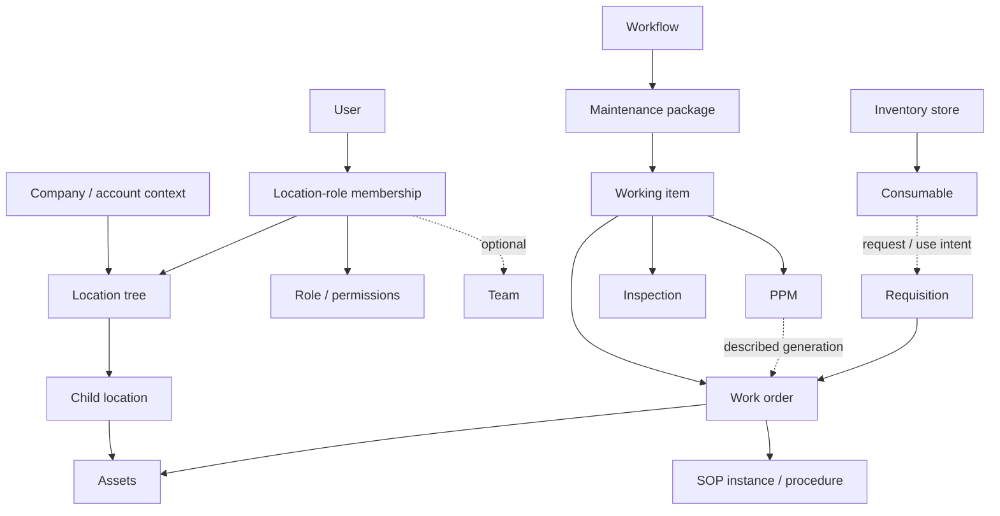

# Observed model and architecture

Research date: 18 October 2026, Asia/Qatar. Confidence classes: **O** = observed UI/DOM; **C** = interface claim or configurable affordance; **I** = inference; **U** = unresolved. A diagram here explains visible relationships; it is not a recovered database schema.

## Product model

| Concept | Observed properties or relationships | Evidence | Boundary |
|---|---|---|---|
| Company/account | Branding, language, timezone, size, feature flags | S075–S080 | Company isolation claimed in reporting, not tested |
| Location | Parent/child levels, main/current flags, active flag, address, coordinates, manager | S027–S029 | Generic numeric levels; building/space types not proven |
| Location membership | User + location + role, optional team | S072 | Configuration intent; endpoint enforcement untested |
| Team | Name, location, manager, members | S073–S074 | Hierarchy claimed, parent-team field not observed |
| Category | Name, description, location shown in registry, active, sort order in form | S065–S066 | No parent-category picker demonstrated |
| Asset | Type, status, location, metadata, acquisition, warranty, parent text field, QR, documents, WO/PPM tabs | S030–S037, S091, S105–S106 | Actual transitions and history retrieval not successful |
| Working item | Work order, PPM and inspection share classification, assignment, priority, labels, category/workflow context | S001–S014, S043–S049 | Common underlying entity inferred from IDs and repeated UI |
| Work order | Status, due date, maintenance/service types, assets, parts, SOP, attachments, execution gates, cost/time, history | S006–S012, S092–S098 | Saving/completion/approval not tested |
| PPM schedule | Calendar selections, start/end, execution time/timezone, assignees, assets, parts, SOP | S044–S047 | Work-generation behavior described in UI, not observed |
| Inspection | Classification, scheduled status, priority, assignee, category, creation date | S048–S049 | No filled checklist or failed-answer corrective flow observed |
| Workflow | Owner, category, status, strategy, trigger, packages | S055–S061, S102–S104 | Visual model verified; executable engine not verified |
| Maintenance package | Nested within workflow, parallel badge, working-item membership, progress | S056, S060 | Independent route sparse; editor actions did not expand in one attempt |
| SOP | Library distinguishes templates/instances; sections, fields, version, category | S050–S054 | Version string exists; immutable published versioning unproven |
| Consumable | Type, SKU, store, UOM, min/max stock, price/currency, expiry | S041–S042 | Empty inventory; no ledger or receipt observed |
| Requisition | Date, item, quantity, work-order link, status | S040 | Empty queue; approval/issue transitions untested |
| Maintenance request | Submitted/approved/rejected/in-progress buckets | S063–S064 | No requests or public submission inspected |

Solid arrows summarize observed UI associations or containment. They do not establish cardinalities, foreign keys, cascade rules or authorization. The PPM generation and inventory-use links are explicitly less certain.

## Frontend findings

**O:** the site has a client-routed manager application, nested module URLs, drawers/modals, shared dropdowns, filter controls, tables, a paginator and tab panels. The persistent top bar and sidebar remain while content routes change. Several content routes briefly return only the shell during loading; one workflow return required a reload to recover its heading and controls.

**O/I:** rendered DOM classes include Angular-style `ng-…` markers. The observed script inventory contains `runtime.js`, `polyfills.js`, `vendor.js`, `main.js`, `src_app_pages_pages_module_ts.js` and lazy chunk filenames referring to `tn-ui` datepicker, modal, advanced-filter and paginator components. This is strong evidence of an Angular-family application with reusable component families and lazy module boundaries. Exact Angular version, state-management implementation, source ownership and build configuration were not recovered. Filenames are architectural clues, not source-code analysis. [Asset inventory](../07_EVIDENCE/FRONTEND_ASSET_INVENTORY.json).

**O:** the page observes Firebase app/messaging scripts, a Google Maps script, Boxicons CSS, font assets and Bootstrap-style CSS custom properties. The location editor visually uses Leaflet/OpenStreetMap. Script presence does not prove successful integration, notification delivery or active use on this route. `bpmn.io` is visibly credited by the visual editor; this supports the editor library identity, not the semantics of its execution engine.

**O:** Poppins is the measured body font, 13px with 19.5px line height. Body background is `#f8f8fb`, text `#495057`; many buttons use a blue/purple primary family. Exact measured properties and viewport are retained in [design tokens](../03_UI_UX/DESIGN_TOKENS_OBSERVED.json). These can inform an independent design system, but should not dictate Atlas's frontend stack.

## API evidence

No credentials, cookies, tokens, storage contents, authenticated response bodies or hidden application state were extracted. No API endpoint was directly invoked outside the normal UI. There is no HAR, full OpenAPI schema or traffic-derived data model in this package.

The following **literal paths were displayed by UI errors**:

| UI action | Displayed request/error | Confirmed conclusion |
|---|---|---|
| Generate Work Order Summary | `Cannot POST /api/rapport-management/work-order-summary` | That report attempt failed with Not Found in this session (S019–S020) |
| Open file library | `Cannot GET /api/storage/browse/location/<location-id>?types=location,work-orders,assets,ppm,sop-templates,company-settings` | The location resource-browser attempt failed (S083) |
| Asset overview/history | Failed to retrieve asset status history | Retrieval failed; no endpoint URL was exposed in the captured dialog (S031/S037) |

The `/api/…` prefix and error style do not establish a backend framework, database or service topology. REST API/webhook access appears in the feature flags, but working integration configuration was not demonstrated. UUID-like record IDs and numeric hierarchy levels are UI observations, not a schema contract.

## Business logic: strongest and weakest evidence

**Confirmed interaction:** list/grid/Kanban/calendar surfaces open; work-order tabs switch; the full work-order page shows three related assets; SOP field type selection adds a text field to an unsaved draft; a local validation rule can be added to its inspector; per-location role assignments appear in onboarding; execution-strategy choices appear in workflow setup.

**Claimed only:** automatic PPM work-order generation; sequential dependencies; conflict detection; RAG and intelligent automation; native mobile availability; real-time dashboards; audit delivery; API/webhook integrations. Some claims conflict with more specific screens: financial mapping is unfinished, email/SMS are Coming Soon and AI is offline. Preserve the more specific observation.

**Unknown:** tenant enforcement, server validation, transition policy, transactional guarantees, data retention, job retries, idempotency, concurrency control, offline mobile sync, accessibility by keyboard/screen reader, report correctness, production scale and edition coverage. Resolving these would require authorized behavioral tests or further documentation, not more screenshots.

## Proposed Atlas architecture direction

Keep Atlas's Java service layer, relational persistence, React application and Expo mobile app. Add CAFM contracts to that foundation instead of translating SentrixFM's frontend implementation. Proposed seams are: location scope and membership; work execution; schedule occurrences; inventory movements/receipts; procedure definitions/results; policy/SLA clocks; metrics/read models; and reliable integration events.

A common query context should carry company, permitted site scope, selected location subtree, time window and user filters. The same context must power counts, lists, exports and drill-down. A common detail projection should power drawer and full page. Domain mutations must validate authorization, state, required evidence and concurrency before writing or dispatching side effects. These are **design proposals**, not recovered SentrixFM internals.
